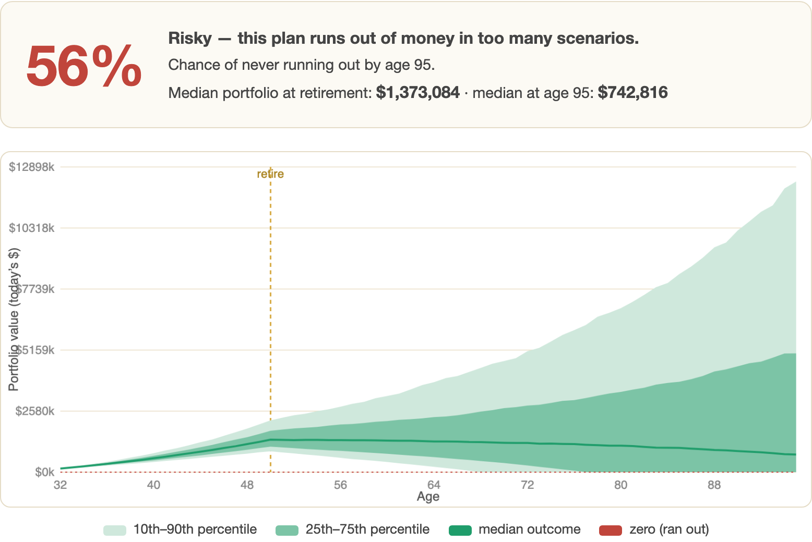

# When can I retire? A FIRE Monte Carlo simulator

A browser-based retirement simulator that runs 5,000 randomized market paths and reports the probability your savings last, plus the earliest retirement age that reaches 90%.

[Live app](https://lyhjeremy.github.io/fire-retirement-simulator/) · [Write-up](https://lyhjeremy.github.io/fire-retirement-simulator/overview/)

Design and copy follow [these standards](https://github.com/lyhjeremy/lyhjeremy/blob/main/DESIGN_STANDARDS.md).

## What the default plan shows

I ran the app's default plan (age 32, $150k saved, $40k a year contributed, $60k a year spent, 5.0% real return, 13.0% volatility, plan until 95) three times and changed only the retirement age:

| Retire at | Success rate | Median at retirement | Median at 95 |
|---|---|---|---|
| 40 | 3% | $582,492 | $0 |
| 50 | 56% | $1,373,084 | $742,816 |
| 59 | 90% | $2,414,598 | $5,558,280 |

The built-in "Find earliest age for 90% success" search returned 59. The middle row is the interesting one: retiring at 50 means withdrawing about 4.4% of the median portfolio, which is close enough to the 4% rule to look safe, and yet 44% of paths run out before 95. Every run uses fresh random draws, so a rerun moves these figures slightly.

## How a run works

Each of the 5,000 paths starts from current savings and steps forward one year at a time to the plan-until age. A year's return (in real terms) is drawn from a normal distribution with the mean and volatility you set, using a Box-Muller transform; contributions are added while you work and spending is subtracted once you retire. A path whose balance drops below zero counts as failed, and the success rate is the share that never do. The fan chart plots the 10th, 25th, 50th, 75th and 90th percentile balance at every age.

The earliest-age search tries each retirement age in turn at 2,500 paths, stops at the first one that reaches 90%, and reruns that age at 5,000 paths for the card you see.

The whole thing is one HTML file of vanilla JavaScript with a `<canvas>` chart. It has no dependencies, build step, backend or analytics, and nothing you type leaves the browser. To run it, open `index.html` in a browser or use the [live app](https://lyhjeremy.github.io/fire-retirement-simulator/).

## What it leaves out

Returns are independent normal draws. Market returns have fatter tails, and bad years tend to cluster, so the model is probably somewhat optimistic about the worst cases. Return and spending are also held constant in real terms, and the model has no taxes, pensions, stock/bond glide path, one-off costs or spending cuts in bad years.

It is an educational tool for comparing plans and does not give financial advice.

## License

[MIT](LICENSE) © 2026 Jeremy Lee
