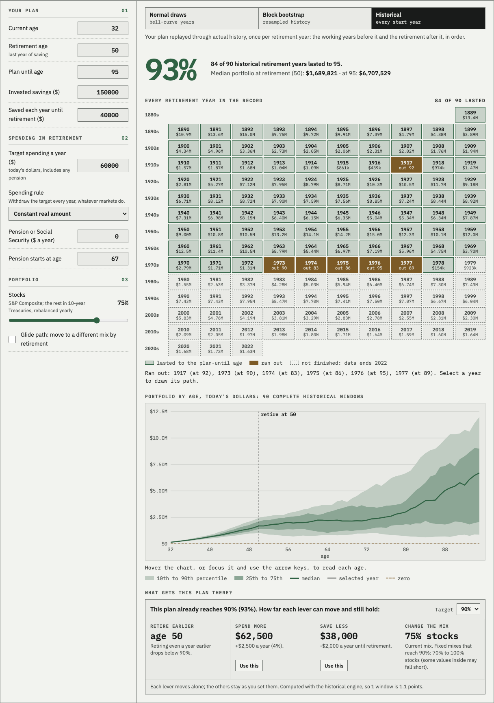

# When can I retire? A FIRE simulator on 152 years of market history

A browser-based retirement simulator built on US stock and bond returns from 1871 to 2022. It replays a plan through every historical retirement year, resamples history into thousands of paths, or uses bell-curve draws for comparison, and finds the smallest change that gets the plan to 90%.

[Live app](https://lyhjeremy.github.io/fire-retirement-simulator/) · [Write-up](https://lyhjeremy.github.io/fire-retirement-simulator/overview/) · [writeup.md](writeup.md)

Design and copy follow [these standards](https://github.com/lyhjeremy/lyhjeremy/blob/main/DESIGN_STANDARDS.md).



## What the default plan shows

Default plan: age 32, $150k invested, $40k a year saved until retiring at 50, $60k a year spent after that, plan until 95, 75% stocks and 25% 10-year Treasuries rebalanced yearly. Everything is in today's dollars.

| Engine | Success | Median at 95 |
|---|---|---|
| Normal draws, history's mean and spread | 82.2% of 5,000 paths | $9,044,391 |
| Block bootstrap, 10-year blocks | 84.8% of 5,000 paths | $9,306,298 |
| Historical replay | 84 of 90 retirement years (93.3%) | $6,707,529 |

The historical failures are the 1917 retiree and the 1973 to 1977 retirees, who run out between 83 and 95. 1929 and 1966, the classic failures for a 30-year retiree, survive here because the working years before them built large balances. Under the bootstrap the solver says the plan reaches 90% by retiring at 52, spending $51,500, or saving $48,500 a year; no fixed stock/bond mix gets there.

*Superseded on 2026-10-28.* Before the upgrade the app drew a single return from a normal distribution with a 5.0% mean and 13.0% volatility, and reported 3% at 40, 56% at 50 and 90% first at 59 for the same plan. With a fixed seed that assumption gives 54.3% at 50. Most of the change comes from the return assumption: US stocks returned 6.9% a year after inflation over 1871 to 2022.

## Checks

`python3 scripts/check_engine.py --js` runs these and writes [`data/validation.json`](data/validation.json).

- **4% rule, 30 years, historical windows.** For start years 1926 to 1966, this data gives 92.7% at 50/50 (Trinity study, 1998: 95%) and 95.1% at 75/25 (Trinity: 98%). Failed start years: 1964 to 1966 at 50/50, 1965 and 1966 at 75/25. The highest rate that survives every window is 3.63% at 50/50 and 3.75% at 75/25, against Bengen's (1994) 4.15%. Damodaran's calendar-year series gives the same failing years, so the January-to-January timing is not the cause. Trinity used long-term corporate bonds and Bengen intermediate Treasuries; this uses 10-year Treasuries.
- **Holdout.** The bootstrap and normal engines fitted on 1871 to 1945 only, asked about 30-year 75/25 retirements, then compared with the 48 retirements that started 1946 to 1993. At 4%: bootstrap 96.4%, normal 92.6%, actual 91.7%. At 5%: 87.8%, 81.1%, 72.9%. Both engines overstated post-war success from 4% up; the windows overlap heavily, so the size of the miss is uncertain.
- **Port.** `scripts/engine.py` is a line-for-line Python port of `engine.js`. The check runs 18 cases through both (engine.js in headless Chromium) and requires identical results.

## Data

`scripts/build_returns.py` builds [`data/returns.json`](data/returns.json) from Robert Shiller's monthly [`ie_data.xls`](http://www.econ.yale.edu/~shiller/data.htm). Each year runs January to January.

- Stocks: S&P Composite total return, chaining (P[m+1] + D[m]/12) / P[m] monthly.
- Bonds: a constant-maturity approximation from the GS10 yield (Shiller's long-term government yield before 1953). Buy a 10-year par bond at January's yield y0, collect the coupon, sell it a year later as a 9-year bond at the next January's yield y1: R = y0 + y0(1 - (1 + y1)^-9)/y1 + (1 + y1)^-9 - 1.
- Inflation: January CPI to January CPI; real return = (1 + nominal) / (1 + inflation) - 1.

Shiller's file runs to September 2023 with estimated CPI for its last two months, so the last full year is 2022: 152 years. Real stocks average 8.39% (17.87% standard deviation, 6.86% compounded); real bonds 2.67% (8.61%); correlation 0.19. Against Damodaran's `histretSP.xls` over 1928 to 2022 the means agree within 0.07 points and single years correlate at 0.97 (stocks) and 0.97 (bonds); [`data/crosscheck.json`](data/crosscheck.json) lists sample years. The bond approximation matches Shiller's own monthly bond-return column to 0.34 points a year on average.

## How the engines work

All three share one path function in [`engine.js`](engine.js). Savings are added at the end of each working year; in retirement, spending (less any pension) is withdrawn at the start of each year; the portfolio is rebalanced yearly to the stock share, which can follow a straight-line glide path to a different share at retirement.

- **Normal.** Stock and bond returns drawn each year from a bivariate normal with the data's means, standard deviations and correlation. Stock mean and volatility are adjustable.
- **Block bootstrap.** Each path strings together runs of consecutive years (stock and bond together) starting at random years, wrapping from 2022 to 1871. Block length 1 to 20, default 10.
- **Historical.** One window per retirement year, with the working years taken from the years just before it. Windows that run past 2022 are drawn in the start-year grid but not counted.

Spending rules: constant real spending; a percentage of the portfolio between a floor and ceiling (percent of target); and Guyton-Klinger-style guardrails that cut spending 10% when the withdrawal rate rises 20% above its starting level (not in the last 15 years) and raise it 10% when it falls 20% below, within the floor and ceiling. A pension or Social Security amount reduces withdrawals from the age it starts.

The solver moves one lever at a time: first later retirement age, highest spending and lowest saving (both to $500, by bisection), and the fixed stock share nearest the current one that reaches the target. If the plan already clears the target it reports how far each lever can move the other way. Random engines reuse the same 5,000 seeded paths for every candidate. It runs in a Web Worker (inline when opened from `file://`).

## Run it

Open `index.html` in a browser, or use the [live app](https://lyhjeremy.github.io/fire-retirement-simulator/). To rebuild the data and rerun the checks (Python 3 with `xlrd`; `playwright` for the `--js` comparison):

```bash
python3 scripts/build_returns.py --download   # raw files go to ~/data-cache/fire-retirement-simulator/
python3 scripts/check_engine.py --js
```

No libraries, build step, backend or analytics; nothing you type leaves the browser.

## Limitations

This is one country's history, and the US had one of the best markets of the period; the holdout shows the random engines were too optimistic about post-war retirements even on US data. There are no taxes, fees, one-off costs or age-related spending changes, and bonds are a single 10-year Treasury series. A long plan has few complete historical windows (90 for the default, heavily overlapping). It is an educational tool and does not give financial advice.

## License

[MIT](LICENSE) © 2026 Jeremy Lee
